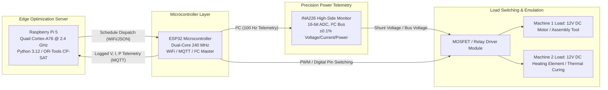

# Peak-Aware Energy-Cost Production Scheduling Under Industrial Tariff Structures
### *A Multi-Objective Optimization Study with Physical Testbed Validation*

[](https://www.python.org/)
[](https://developers.google.com/optimization)
[](09_hardware/current_hardware_spec.md)
[](https://sdgs.un.org/goals/goal9)
[](https://rvce.edu.in)
[](04_mathematical_model/verification/verify_benchmark.py)

---

## 📖 Executive Summary

Small and medium-sized manufacturing enterprises (MSMEs) operate under two-part industrial electricity tariffs consisting of:
1. **Time-of-Use (TOU) Energy Consumption Charges ($\text{₹/kWh}$):** Variable pricing based on hourly demand tiers (Off-Peak, Normal, Peak).
2. **Maximum Peak Demand Charges ($\text{₹/kVA/month}$ or $\text{₹/kW}$):** Capacity penalty fees assessed on the single highest recorded instantaneous power demand interval during the billing cycle.

Conventional production scheduling algorithms focus solely on minimizing makespan ($C_{\max}$) or minimizing energy cost ($EC$). However, pure energy-cost scheduling naturally shifts high-power machines into cheap off-peak hours, creating **severe unmanaged coincident power spikes ($P_{\max}$)**. The resulting demand charge penalties frequently erase or exceed the energy savings!

This research project formulates, solves, and physically validates a **tri-objective, peak-aware scheduling framework** for unrelated parallel machines ($R$). We systematically determine the economic boundary conditions under which peak awareness outperforms classical energy-only scheduling.

---

## 🎯 Primary Research Question

> **"Under what combinations of demand-charge intensity ($\rho$), time-of-use (TOU) tariff differential, workload intensity, and machine-power heterogeneity does peak-aware multi-objective production scheduling provide a statistically significant economic benefit over energy-cost-only scheduling?"**

### Core Hypotheses
* **H1 (Primary):** Peak-aware scheduling ($\min EC + \rho P_{\max}$) produces schedules with lower total electricity bills than energy-cost-only scheduling ($\min EC$) if and only if the demand-charge intensity $\rho$ exceeds a distinct mathematical threshold $\rho^*$.
* **H2:** The economic benefit of peak-aware scheduling increases monotonically with higher demand-charge rates, larger TOU spreads, tighter workload deadlines, and higher machine heterogeneity.
* **H3 (not tested in Phase 3: no hardware was built):** Deterministic scheduling models driven by measured machine power profiles predict aggregate facility energy draw within an empirically validated $\pm 5\%$ error margin on a physical hardware testbed.

---

## 🔬 Key Verified Findings (Canonical Benchmark)

To establish an absolute ground-truth baseline without commercial solver bias, we constructed an exhaustive combinatorial verification script ([`verify_benchmark.py`](04_mathematical_model/verification/verify_benchmark.py)). It evaluated all **7,530 feasible non-preemptive schedules** for an 8-hour shift with 4 production jobs, 2 unrelated machines ($M1 = 10\text{ kW}, M2 = 25\text{ kW}$), a baseline load of $2\text{ kW}$, and an illustrative 3-tier tariff matching Karnataka Electricity Regulatory Commission (KERC) HT-2(a) rate levels.

### Benchmark Comparative Results

| Metric | Strategy A<br>*(Makespan-Optimal)* | Strategy B<br>*(Energy-Cost-Optimal)* | Strategy C<br>*(Peak-Aware Optimal)* | Peak-Aware Delta<br>*(Strategy C vs. B)* |
|---|:---:|:---:|:---:|:---:|
| **Makespan ($C_{\max}$)** | **4.0 hours** | 8.0 hours | 8.0 hours | $\mathbf{0.0\text{ h}}$ *(Meets shift deadline)* |
| **Peak Demand ($P_{\max}$)** | 37.0 kW | 37.0 kW | **27.0 kW** | **-10.0 kW (-27.03%)** 📉 |
| **Total Energy** | 156.0 kWh | 121.0 kWh | 141.0 kWh | +20.0 kWh (+16.53%) |
| **Energy Cost ($EC$)** | ₹ 1,031.60 | **₹ 785.60** | ₹ 912.60 | +₹ 127.00 (+16.17%) |
| **Demand Charge ($DC$ @ $\rho = 15$)** | ₹ 555.00 | ₹ 555.00 | **₹ 405.00** | **-₹ 150.00 (-27.03%)** 💰 |
| **Total Modeled Cost ($TEC$)** | ₹ 1,586.60 | ₹ 1,340.60 | **₹ 1,317.60** | **-₹ 23.00 (-1.72%)** ✅ |

### Visual Gantt Comparison & Load Profiles

```text
Schedule A (Makespan-Optimal Baseline — Rushes production; 37 kW coincident spike):
Slot:       1( Off)    2( Off)    3(Peak)    4(Peak)    5(Peak)    6(Norm)    7(Norm)    8(Norm)
M1(10kW):     J1         J1         J3         J3       idle       idle       idle       idle  
M2(25kW):     J2         J2         J4         J4       idle       idle       idle       idle  
P(t) kW:     37.0       37.0       37.0       37.0        2.0        2.0        2.0        2.0 

Schedule B (Energy-Cost-Optimal — Packs jobs into off-peak; unmanaged 37 kW peak):
Slot:       1( Off)    2( Off)    3(Peak)    4(Peak)    5(Peak)    6(Norm)    7(Norm)    8(Norm)
M1(10kW):     J1         J1         J2         J2         J2         J4         J4         J4 
M2(25kW):     J3       idle       idle       idle       idle       idle       idle       idle  
P(t) kW:     37.0       12.0       12.0       12.0       12.0       12.0       12.0       12.0 

Schedule C (Peak-Aware Optimal — Staggers operations; caps demand at 27 kW):
Slot:       1( Off)    2( Off)    3(Peak)    4(Peak)    5(Peak)    6(Norm)    7(Norm)    8(Norm)
M1(10kW):    idle       idle        J1         J1         J2         J2         J2       idle  
M2(25kW):     J4         J4       idle       idle       idle       idle       idle        J3 
P(t) kW:     27.0       27.0       12.0       12.0       12.0       12.0       12.0       27.0 
```

### The Parametric Break-Even Equation ($\rho^*$)

The exact mathematical break-even demand charge threshold between Strategy B and Strategy C is:

$$\rho^* = \frac{EC^{(C)} - EC^{(B)}}{P_{\max}^{(B)} - P_{\max}^{(C)}} = \frac{912.60 - 785.60}{37.0 - 27.0} = \frac{127.00}{10.0} = \mathbf{12.70 \text{ ₹/kW}}$$

* **When $\rho < \text{₹ } 12.70/\text{kW}$:** Strategy B (Energy-Optimal) dominates because demand charges are too small to justify the energy-rate penalty.
* **When $\rho > \text{₹ } 12.70/\text{kW}$:** Strategy C (Peak-Aware) is strictly superior because peak reduction savings outweigh the higher energy cost.

---

## 🛠️ Hardware Testbed & Measurement Architecture (design only — not built)

> **Status (Nov 2026):** the testbed below is a **design**. No parts were procured and nothing was measured; the Phase 3
> demonstration is software-only (CLI + Streamlit). Figures such as sensor accuracy and telemetry rate are component
> datasheet/design targets, not measured performance.

The planned design deploys the mathematical schedule to a low-voltage (12V DC) programmable machine-load testbed:



> **Electrical Safety Notice:** All laboratory experiments operate strictly on safe **12V DC**. The planned 12V 10A power supply unit (SMPS) would be housed in an industrial enclosed chassis with zero student exposure to AC mains voltages.

---

## 📂 Repository Organization

```text
EL/
├── 00_project_overview/       # Authoritative master context, conversation logs, and handoff summaries
│   ├── energy_scheduling_project_master_context.md
│   ├── EL_CONVERSATION_LOG.md
│   └── historical/            # Preserved analysis and historical decision archives
├── 01_rubric/                 # Institutional Experiential Learning (EL) rubric circulars and guides
├── 02_research/               # Literature review, paper extractions, and verification notes
│   ├── literature/
│   │   ├── papers/            # Full-text PDFs of core surveyed literature
│   │   ├── literature_matrix/ # Comprehensive literature-to-model matrix
│   │   └── notes/             # Equation-level derivations and paper notes
│   └── validation/            # Pre-implementation mathematical validations
├── 03_tariff/                 # Industrial tariff reference models and official KERC orders
│   ├── official/              # KERC FY2026-27 Bescom HT-2(a) tariff gazettes
│   └── tariff_reference.md    # Tariff equations and sensitivity parameters
├── 04_mathematical_model/     # Mathematical formulation and independent verification
│   ├── derivation/            # Formal derivations, assumptions, and literature mapping
│   ├── formulation/           # Mathematical Model v1 (unrelated parallel machines)
│   └── verification/          # Standalone Python combinatorial verifier (verify_benchmark.py)
├── 05_planning/               # Master execution plan and staged task roadmaps
├── 07_src/                    # Phase 3 code: model/ (CP-SAT solver, front, billing), experiments/, analysis/,
│                              #   app/ (CLI + Streamlit prototype), scripts/
├── docs/handoff/              # Phase 3 specs, results and status (ROADMAP-FINAL, SPEC-003, OVERNIGHT-STATUS, ...)
├── examples/                  # Demo instances (benchmark + generated shops) in editable JSON
├── results/                   # Raw experiment outputs with manifests and digests (pilot27, cal2, probes, smoke)
├── tests/                     # Automated tests (pytest), incl. exhaustive-oracle checks
├── 09_hardware/               # Testbed hardware specifications (INA226, ESP32, RPi 5, DC loads)
├── 11_report/                 # Project documentation, presentations, and phase reports
├── 12_tools/                  # PDF and data processing helper utilities
├── .gitignore                 # Standard clean Git exclusions
├── PROJECT_STATUS.md          # Real-time tracking of completed and upcoming milestones
└── README.md                  # Master project documentation
```

---

## 🚀 Quickstart & Verification Guide

### 1. Prerequisites
- Python 3.10+ (Standard Library only for verification)
- Git

### 2. Phase 3 prototype (Python 3.13)
```bash
pip install -r requirements.txt            # exact pins; full lock: requirements-lock.txt
python -m pytest -q                        # automated tests
python 07_src/scripts/reproduce_benchmark.py
python 07_src/app/cli.py solve --instance examples/shop_8x3_kerc.json --out out/   # schedules, bills, charts
streamlit run 07_src/app/ui.py             # interactive demo
```
Monthly bills from the tool are **partial estimates** (demand charge plus the energy of the scheduled shift only).

### 2b. Clone the Repository
```bash
git clone https://github.com/SARTHAK-CHAVARE/EL.git
cd EL
```

### 3. Run the Exhaustive Combinatorial Verification Script
The verification script is completely self-contained and does not require third-party solvers or dependencies:

```bash
python 04_mathematical_model/verification/verify_benchmark.py
```

#### Expected Output
```text
==========================================================================================
  INDEPENDENT REPRODUCIBLE VERIFIER FOR SCHEDULING BENCHMARK INSTANCE
  Phase 2C — Formal Mathematical Verification Gate
==========================================================================================

[STEP 1] Enumerating all feasible schedules...
  -> Generated 7530 feasible schedules.
  -> Unique canonical schedules: 7530

[STEP 2] Evaluating all 7530 schedules (Eq. 7-17)...
  -> Successfully evaluated all 7530 schedules.
  -> Makespan range: [4, 8] slots
  -> Energy cost range: [INR 785.60, INR 1324.60]
  -> Peak demand range: [27.0, 37.0] kW

[STEP 3] Solving Strategies A, B, C under Sequential Lexicographic Optimization...
...
[STEP 5] Formal Assertions: 24 PASSED, 0 FAILED out of 24 assertions.
==========================================================================================
  VERDICT: BENCHMARK VERIFIED — READY FOR SOLVER IMPLEMENTATION REVIEW
==========================================================================================
```

---

## 📜 Official Industrial Tariff Mapping (KERC FY2026–27)

Tariff structures are calibrated against the official **Karnataka Electricity Regulatory Commission (KERC) Tariff Order for BESCOM HT-2(a)** high-tension industrial consumers:

| Tariff Period | Slot Range (Illustrative Shift) | Clock Hours (Official Tariff) | Energy Charge Rate |
|---|:---:|:---:|:---:|
| **Off-Peak Incentive** | Slots 1–2 | 22:00 – 06:00 | **₹ 5.60 / kWh** (-₹ 1.00 rebate) |
| **Peak Surcharge** | Slots 3–5 | 18:00 – 22:00 | **₹ 7.60 / kWh** (+₹ 1.00 surcharge) |
| **Normal Industrial Rate** | Slots 6–8 | 06:00 – 18:00 | **₹ 6.60 / kWh** (Base tariff) |

* **Official Utility Billing Demand:** ₹ 350 / kVA / month on billing demand = max(recorded MD, 0.90 × contract demand). The MD integration interval is **not verified** against the tariff order (the order's only 15-minute reference concerns data updates, not metering).
* **Shift Sensitivity Parameter:** Modeled as a continuous variable $\rho \in [0, 50]\text{ ₹/kW}$ per 8-hour shift equivalent.

---

## 📚 Core Literature Matrix

Our mathematical formulation synthesizes and improves upon foundational papers:

| Citation | Venue | Scheduling Model | Objectives Considered | Discovered Limitations / Addressed Gaps |
|---|---|---|---|---|
| **Mouzon et al. (2007)** | *Int. J. Prod. Res.* | Single Machine ($1$) | $\min \sum C_j, \min TEC$ | Breakeven idle shutdown rule; zero ToU or peak demand tracking. |
| **Gahm et al. (2016)** | *Eur. J. Oper. Res.* | Taxonomy / Review | Energy-efficient survey | Highlights peak charges in only <5% of papers; zero physical validations. |
| **Mavrotas (2009)** | *Appl. Math. Comput.* | Multi-Objective Programming | AUGMECON Method | Avoids weakly dominated Pareto solutions; foundation for lexicographic solving. |
| **Catanzaro et al. (2023)** | *Eur. J. Oper. Res.* | Survey (135+ papers) | ToU job scheduling | Zero papers model demand charges; proves clear academic research gap. |
| **Sung & Kwon (2026)** | *Appl. Energy* | Identical Parallel ($P$) | $\min EC + DCR \cdot P_{\max}$ | Explicit demand charge model; limited to identical machines with zero idle power. |
| **Moon et al. (2013)** | *Int. J. Adv. Manuf. Technol.* | Unrelated Parallel ($R$) | $\min (C_{\max} \cdot PC + EC)$ | **Flaws Discovered:** Omitted machine non-overlap constraint and used flawed makespan formula. **Corrected in our Model v1.** |

---

## 🗓️ Project Roadmap & Milestone Tracker

| Phase | Timeframe | Focus Area | Status | Key Deliverable |
|:---:|:---:|---|:---:|---|
| **Phase I** | Aug 2026 | Problem Scoping & Literature Review | ✅ **Completed** | Literature Matrix & Problem Definition |
| **Phase II** | Sep – Oct 2026 | Mathematical Model v1 & Benchmark Proof | ✅ **Completed** | Model v1, Combinatorial Verifier (24/24 tests) |
| **Phase III-A** | Nov 2026 | Production Solver, Energy–Peak Front, Billing | ✅ **Completed** | CP-SAT engine; exact front & break-even; partial KERC bill (branch `phase3-experiments`) |
| **Phase III-B** | Nov – Dec 2026 | Factorial Study (SPEC-003: 540 + 60 instances) | 🔄 **Designed & smoke-tested; main run pending** | `docs/handoff/SPEC-003-main-study.md`, `P4-SMOKE-RESULTS.md` |
| **Phase III-C** | Nov 2026 | Prototype (CLI + Streamlit) | ✅ **Completed** | `07_src/app/`, `examples/` |
| **Phase III-D** | 1 Dec 2026 (demo) · 7 Dec 2026 (submission) | Demo, Report & Presentation | ⏳ **Upcoming** | Demo, final report, poster/PPT |
| *Hardware testbed* | — | INA226 physical validation | ❌ **Not built** (out of scope for the Dec 2026 submission) | Design only (`09_hardware/`) |

---

## 👥 Project Team & Acknowledgments

- **Student Investigators:** Experiential Learning (EL) Project Team, Department of Electrical & Electronics Engineering / Computer Science & Engineering
- **Academic Institution:** [RV College of Engineering (RVCE), Bengaluru](https://rvce.edu.in) — Autonomous Institution Affiliated to Visvesvaraya Technological University (VTU)
- **Course Context:** Experiential Learning (EL) — III Semester
- **Guidance & Mentorship:** Faculty Advisors and Review Committee, RVCE Experiential Learning Cell

---

## 📄 License
This repository is maintained for academic research, education, and open-source verification under the **MIT License**.
