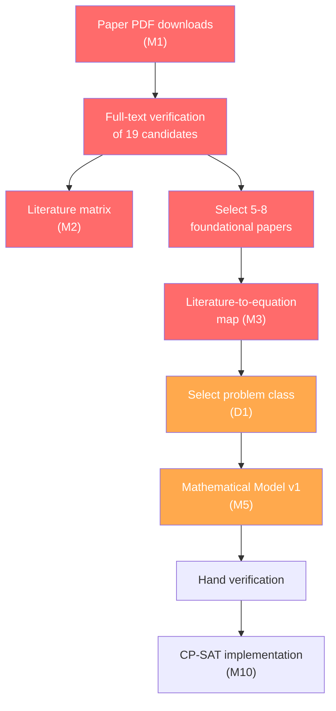

# PROJECT AUDIT REPORT
**Date:** 2026-10-14  
**Auditor role:** Technical Project Manager  
**Scope:** Read-only audit of all project documents and workspace. No files modified.

---

## 1. AUTHORITATIVE MASTER CONTEXT AND EXECUTION PLAN

### Identified hierarchy (confirmed consistent across all documents)

| Rank | Document | Path | Status |
|---|---|---|---|
| 1 | **Project Master Context V2** | [`energy_scheduling_project_master_context.md`](file:///c:/Project/EL/00_project_overview/energy_scheduling_project_master_context.md) | ✅ CURRENT / AUTHORITATIVE (2026-10-03) |
| 2 | **Master Execution Plan** | [`master_execution_plan.md`](file:///c:/Project/EL/05_planning/master_execution_plan.md) | ✅ CURRENT (V1.0, 2026-10-02) |
| 3 | **Tariff Reference** | [`tariff_reference.md`](file:///c:/Project/EL/03_tariff/tariff_reference.md) | ✅ CURRENT |
| 4 | **Hardware Specification** | [`current_hardware_spec.md`](file:///c:/Project/EL/09_hardware/current_hardware_spec.md) | ✅ CURRENT |
| 5 | **PROJECT_STATUS.md** | [`PROJECT_STATUS.md`](file:///c:/Project/EL/PROJECT_STATUS.md) | ✅ CURRENT (tracks phase) |

The source-of-truth chain is explicitly defined in Master Context §0 and confirmed in `PROJECT_STATUS.md`. All five documents agree on hierarchy and current phase.

### Historical / superseded files (correctly retained)

| File | Location | Notes |
|---|---|---|
| Old master context | [`historical/energy_scheduling_project_master_context_old.md`](file:///c:/Project/EL/00_project_overview/historical/energy_scheduling_project_master_context_old.md) | 383 KB — contains PZEM-004T era content |
| Research validation | [`historical/energy_scheduling_research_validation.md`](file:///c:/Project/EL/00_project_overview/historical/energy_scheduling_research_validation.md) | Historical gap analysis |
| SDG9 analysis | [`historical/sdg9_project_analysis.md`](file:///c:/Project/EL/00_project_overview/historical/sdg9_project_analysis.md) | Project selection artifact |
| SDG9 audit | [`historical/sdg9_project_audit.md`](file:///c:/Project/EL/00_project_overview/historical/sdg9_project_audit.md) | Project selection artifact |

> [!NOTE]
> Historical files are NOT marked with the `[!WARNING] HISTORICAL / REFERENCE DOCUMENT` banner that Master Context §64 requires. This is a **low-priority cosmetic gap** — the files sit in a `historical/` subdirectory, which provides implicit context, but the formal banner is absent.

---

## 2. HARDWARE DESIGN CONFIRMATION

### Current design: INA226 + ESP32 + Raspberry Pi 5 + 12V DC loads — **CONFIRMED**

All four authoritative documents agree:

| Component | Role | Confirmed in |
|---|---|---|
| **INA226** (×3) | DC V/I/P measurement, I²C | Master Context §28, Exec Plan §12.1, Hardware Spec §2 |
| **ESP32-WROOM-32** | Sensing, control, MQTT/WiFi | Master Context §31, Exec Plan §12.1, Hardware Spec §3 |
| **Raspberry Pi 5** | Edge optimizer (OR-Tools CP-SAT) | Master Context §32, Exec Plan §12.1, Hardware Spec §6 |
| **12V DC loads** | Machine-load emulators (motor, heater, LED) | Master Context §30, Exec Plan §13.1, Hardware Spec §5 |
| **Relay/MOSFET** | Load switching | Master Context §27, Exec Plan §12.1, Hardware Spec §4 |
| **12V 10A SMPS** | Power supply (enclosed) | Exec Plan §12.2 |

### PZEM-004T: **CONFIRMED SUPERSEDED**

- Master Context §29: "superseded for the planned 12V DC testbed"
- Hardware Spec §9: "NOT part of the current 12V DC testbed"
- `PROJECT_STATUS.md`: "PZEM → INA226 hardware correction" listed under Completed
- Exec Plan §12.1: explicit `[!IMPORTANT]` correction note
- Literature search prompt: explicit "PZEM-004T is a superseded design" statement

No live document references PZEM-004T as current.

---

## 3. LITERATURE REVIEW STATUS AND ROUND-1 CANDIDATE LIST

### Status: Round-1 candidate list EXISTS, verification INCOMPLETE

The Round-1 candidate list is at [`literature_search_round_1.md`](file:///c:/Project/EL/02_research/literature/notes/literature_search_round_1.md).

**Date:** 2026-10-03  
**Status header:** "CANDIDATE LIST — Requires verification against full-text PDFs"

### Candidate papers identified: 19 entries

| Category | IDs | Count | Key papers |
|---|---|---|---|
| **A: Foundational / Surveys** (pre-2020) | P01–P04 | 4 | Mouzon 2007, Gahm 2016 survey, Mavrotas 2009 AUGMECON, Mavrotas 2013 AUGMECON2 |
| **B: Energy-Aware Scheduling** (2013–2024) | P05–P09 | 5 | Dai 2019, Zhang 2017, Meng 2019, **Fang 2013 (peak)**, Moon 2013 (TOU) |
| **C: Peak / Demand-Charge Aware** | P10–P12 | 3 | Fang 2016, Biel 2016 survey, Aghelinejad 2018 |
| **D: TOU / Tariff-Aware** | P13–P15 | 3 | Zhang 2014, Wu 2019, Che 2017 |
| **E: Multi-Objective Methodology** | P16 | 1 | OR-Tools CP-SAT documentation (not peer-reviewed) |
| **F: Physical / Tariff / Edge** | P17–P19 | 3 | Physical validation gap (confirmed), KERC 2025 order, MoP 2023 rules |

### Recommended foundational papers: 7 identified

P03 (Mavrotas AUGMECON), P08 (Fang 2013 peak), P09 (Moon 2013 TOU), P02 (Gahm 2016 survey), P12 (Aghelinejad 2018), P05 (Dai 2019 FJSP), P10 (Fang 2016 TOU+peak).

### Critical finding: ZERO papers have full-text verification

Every single paper is tagged `REQUIRES FULL-TEXT VERIFICATION`. No PDFs exist in [`02_research/literature/papers/`](file:///c:/Project/EL/02_research/literature/papers/) — the directory is **empty**.

### Downstream artifacts: ALL EMPTY

| File | Status |
|---|---|
| [`literature_matrix/`](file:///c:/Project/EL/02_research/literature/literature_matrix/) | Empty directory |
| [`literature_to_equation.md`](file:///c:/Project/EL/04_mathematical_model/derivation/literature_to_equation.md) | Empty file (0 bytes) |
| [`assumptions.md`](file:///c:/Project/EL/04_mathematical_model/derivation/assumptions.md) | Empty file (0 bytes) |
| [`mathematical_model_v1.md`](file:///c:/Project/EL/04_mathematical_model/formulation/mathematical_model_v1.md) | Empty file (0 bytes) |

---

## 4. READABILITY OF TARIFF REFERENCE AND LITERATURE-SEARCH PROMPT

### Tariff Reference — ✅ READABLE AND WELL-STRUCTURED

[`tariff_reference.md`](file:///c:/Project/EL/03_tariff/tariff_reference.md) is 115 lines, cleanly formatted, and covers:
- KERC source, category (HT-2(a)), study year (FY 2026–27)
- Energy charge (₹6.60/kWh), demand charge (₹350/kVA/month)
- Billing demand formula: BD = max(MD, 0.90 × CD)
- December–June ToD adjustments (±₹1.00/kWh = absolute paise, NOT the ±20% in the Execution Plan)
- kW vs kVA distinction, billing horizon warning, exclusions

### Literature-Search Prompt — ✅ READABLE BUT TRUNCATED

[`literature_search_prompt.md`](file:///c:/Project/EL/02_research/prompts/literature_search_prompt.md) is 71 lines and ends mid-sentence at line 71:
```
adaptation to our project
```
The file appears truncated — the closing workflow diagram and any search-scope instructions that may have followed line 71 are missing. The content that IS present is well-written and correct.

### OPUS_RESEARCH_CONTEXT — ✅ READABLE

[`OPUS_RESEARCH_CONTEXT.md`](file:///c:/Project/EL/02_research/prompts/OPUS_RESEARCH_CONTEXT.md) is a full copy of the Master Context V2 (2,270 lines, ~42 KB). It appears to be a context document prepared for feeding to an LLM research session. Readable and consistent.

### Rubric files

| File | Status |
|---|---|
| [`01_rubric/030 EL Rubrics (1).pdf`](file:///c:/Project/EL/01_rubric/030%20EL%20Rubrics%20(1).pdf) | ✅ PDF exists (274 KB) |
| [`01_rubric/rubric_text.txt`](file:///c:/Project/EL/01_rubric/rubric_text.txt) | ⚠️ EMPTY — contains only `=== PAGE 1 ===` etc. placeholder headers, no actual text |
| [`03_tariff/extracted/page_1.png`](file:///c:/Project/EL/03_tariff/extracted/page_1.png) | ✅ Readable — this is actually the **rubric** circular (RVCE 030/2026-27), not tariff content |
| [`03_tariff/extracted/page_2.png`](file:///c:/Project/EL/03_tariff/extracted/page_2.png) | ✅ Readable — rubric Phase II and III criteria |
| [`03_tariff/extracted/page_3.png`](file:///c:/Project/EL/03_tariff/extracted/page_3.png) | ✅ Readable — rubric Results, Report, Poster criteria |

### Official tariff PDFs

| File | Size | Status |
|---|---|---|
| [`03_tariff/official/kerc doc2.pdf`](file:///c:/Project/EL/03_tariff/official/kerc%20doc2.pdf) | 12 MB | Present |
| [`03_tariff/official/tarif order.pdf`](file:///c:/Project/EL/03_tariff/official/tarif%20order.pdf) | 22 MB | Present |
| [`03_tariff/supporting/media_to_upload1765180920.pdf`](file:///c:/Project/EL/03_tariff/supporting/media_to_upload1765180920.pdf) | 32 MB | Present (unnamed upload artifact) |

---

## 5. CONTRADICTIONS, MISSING FILES, UNFINISHED DECISIONS, AND DEPENDENCIES

### 5.1 Contradictions

| # | Issue | Location A | Location B | Severity |
|---|---|---|---|---|
| **C1** | **ToD representation mismatch** | Tariff Reference uses **absolute ±₹1.00/kWh** adjustments (paise-based, matching KERC Annexure 9) | Exec Plan §3.1 uses **±20% multiplier** model (πbase × 1.20, πbase × 0.80) and cites "national rule" | **HIGH** — the ₹6.60 base × 1.20 = ₹7.92 ≠ ₹7.60. The Master Context §22 uses the correct absolute paise model (₹7.60/₹6.60/₹5.60). The Execution Plan §3.1 table row "ToD peak surcharge +20%" contradicts the tariff reference and master context. |
| **C2** | **Demand charge value** | Tariff Reference and Master Context §22: **₹350/kVA/month** | Exec Plan §3.1: "~₹365/kVA" and §5.2: "ρ = 365 ₹/kVA (the HT-2a rate)" | **MEDIUM** — The execution plan uses ₹365 in multiple places while the tariff reference says ₹350. One must be chosen as canonical. |
| **C3** | **Billing demand formula** | Master Context §22 and Tariff Reference: BD = max(MD, **0.90** × CD) | Exec Plan §3.1: "Billed on max of (recorded MD, **~75%** of sanctioned demand)" | **MEDIUM** — 0.90 ≠ 0.75. The Master Context is more authoritative per the hierarchy. |

### 5.2 Missing files and empty placeholders

| # | Expected file/content | Status |
|---|---|---|
| **M1** | `02_research/literature/papers/` — actual PDFs | **EMPTY** — zero papers downloaded |
| **M2** | `02_research/literature/literature_matrix/literature_to_model_matrix.md` | **MISSING** — directory exists, no file |
| **M3** | `04_mathematical_model/derivation/literature_to_equation.md` | **EMPTY** (0 bytes) |
| **M4** | `04_mathematical_model/derivation/assumptions.md` | **EMPTY** (0 bytes) |
| **M5** | `04_mathematical_model/formulation/mathematical_model_v1.md` | **EMPTY** (0 bytes) |
| **M6** | `01_rubric/rubric_text.txt` | **EMPTY** — placeholder headers only; actual rubric text not extracted |
| **M7** | `02_research/prompts/literature_search_prompt.md` | **TRUNCATED** — ends mid-line at L71 |
| **M8** | `README.md` at project root | **MISSING** — Master Context §62 lists it but it doesn't exist |
| **M9** | `requirements.txt` at project root | **MISSING** |
| **M10** | Source code files (`07_src/model/`, `07_src/solver/`) | **EMPTY** — directory structure exists, no `.py` files |
| **M11** | `tests/` | **EMPTY** |

### 5.3 Misplaced files

| # | Issue |
|---|---|
| **F1** | `03_tariff/extracted/page_1.png`, `page_2.png`, `page_3.png` are **rubric pages**, not tariff extracts. They are in the wrong directory. |

### 5.4 Unfinished decisions

| # | Decision | Status | Blocking |
|---|---|---|---|
| **D1** | Scheduling problem class (JSP vs FJSP vs parallel-machine) | **NOT SELECTED** — Master Context §16 and Round-1 notes say "select after literature analysis" | Blocks mathematical model, implementation |
| **D2** | Final number of testbed channels (3 vs 4) | **NOT DECIDED** — Master Context §27: "final number is a hardware verification decision" | Blocks final BOM |
| **D3** | AUGMECON vs AUGMECON2 | **NOT DECIDED** — both P03 and P04 listed; exec plan says "AUGMECON-style" without committing | Low priority now |
| **D4** | Exact experimental grid sizes | **PRELIMINARY** — pilot design discussed but not frozen | Appropriate — depends on solver performance |
| **D5** | Time-slot granularity mapping | **STATED** in exec plan (15 min model / 15 sec testbed) but not formally verified against KERC MD measurement window (15-min or 30-min) | Should be resolved during model formulation |

### 5.5 Dependencies



> [!WARNING]
> The entire downstream pipeline (model → code → experiments → validation) is blocked on completing the literature verification step. No workaround exists — the project methodology explicitly forbids formulation without literature derivation.

---

## 6. COMPLETED WORK vs PRELIMINARY FINDINGS vs PLANNED WORK vs UNVERIFIED CLAIMS

### ✅ COMPLETED (verified present in workspace)

| Item | Evidence |
|---|---|
| SDG 9 project direction selected | Historical analysis docs exist |
| Rubric obtained | PDF at `01_rubric/`, extracted page images present |
| Project title and scope defined | Master Context V2, §1 |
| Research question and hypotheses formulated | Master Context §3–5 |
| KERC tariff order PDFs obtained | 3 PDFs in `03_tariff/official/` and `supporting/` |
| Tariff reference document written | `tariff_reference.md` (115 lines, internally consistent) |
| Hardware design finalized (INA226 architecture) | `current_hardware_spec.md`, consistent across all docs |
| PZEM → INA226 correction applied | Explicit in all 4 authoritative docs |
| Master Context V2 written | 2,257 lines, 79 sections, comprehensive |
| Master Execution Plan V1 written | 1,235 lines, 22 parts, detailed |
| Repository folder structure created | 14 top-level dirs, subdirectories match Master Context §62 |
| PROJECT_STATUS.md created | Tracks current phase accurately |
| Literature search prompt drafted | 71 lines (truncated but substantive) |
| Literature Round-1 candidate list produced | 19 entries with structured fields |
| Experiment folder structure scaffolded | 10 experiment directories (A–J) |
| Report folder structure scaffolded | chapters/, figures/, final/, references/, tables/ |

### 📋 PRELIMINARY FINDINGS (present but unverified / incomplete)

| Item | Status | Gap |
|---|---|---|
| 19 candidate papers identified | Titles, DOIs, and classifications exist | **ZERO full-text verified**; no PDFs downloaded |
| 7 recommended foundational papers | Prioritized list exists | No mathematical content extracted yet |
| Gap analysis (5 under-explored areas) | Written in Round-1 doc | Based on search-result abstracts, not full-text reads |
| Candidate mathematical formulation | Appears in Master Context §17–21 and Exec Plan Part 4 | Explicitly labeled "not frozen" / "current direction" — awaits literature grounding |
| BOM costed at ₹2,290 | Exec Plan §12.2 | Component-level pricing not purchase-verified |
| Tariff values in `tariff_reference.md` | Written from KERC order | Not yet cross-referenced against specific page numbers in the obtained PDFs |

### 📅 PLANNED WORK (defined but not started)

| Item | Defined in |
|---|---|
| Paper PDF downloads | Round-1 next steps |
| Literature-to-model matrix | Master Context §13 |
| Literature-to-equation traceability | Master Context §15 |
| Problem class selection | Master Context §16 |
| Mathematical Model v1 | Master Context §17, Exec Plan Part 4 |
| Hand verification on 2×2 instances | Exec Plan Actions 4–5 |
| OR-Tools CP-SAT implementation | Exec Plan Actions 1–9 |
| All 10 experiments (A–J) | Exec Plan Part 9 |
| Hardware assembly, calibration, physical validation | Exec Plan Parts 13–15 |
| RPi deployment and benchmarking | Exec Plan Part 16 |
| Full report | Part 21 Definition of Done |

### ⚠️ UNVERIFIED CLAIMS (require source confirmation)

| # | Claim | Location | Issue |
|---|---|---|---|
| **U1** | "No specific scheduling paper found that includes measured power validation" (P17) | Round-1 doc, line 373 | Based on web search only; not a systematic review claim |
| **U2** | KERC tariff values (₹6.60, ₹350, ToD periods) | Tariff Reference | Values are stated but no page-number citations from the actual PDFs in `03_tariff/official/` |
| **U3** | All 19 paper DOIs | Round-1 doc | DOIs listed but not resolved/verified against publisher pages |
| **U4** | "MoP Electricity (Rights of Consumers) Amendment Rules, 2023" mandating ToD ≥10 kW | Round-1 P19, Exec Plan §2.6 | Official document not downloaded or stored in workspace |
| **U5** | Exec Plan §3.1 tariff values marked "REQUIRES OFFICIAL PDF VERIFICATION" | Exec Plan lines 211–223 | Self-flagged as unverified |

---

## 7. STATUS REPORT

### Current Milestone

**LITERATURE → MATHEMATICAL FOUNDATION** (Phase: Literature-to-Equation Audit)

The project has completed project definition, planning, and a preliminary literature search. It is blocked at the transition from candidate paper identification to full-text verification and mathematical extraction.

### Verified Completed Items

1. Project scope, RQs, hypotheses, and honest novelty position — frozen in Master Context V2
2. Hardware architecture decision (INA226 + ESP32 + RPi 5 + 12V DC) — consistent across all docs
3. PZEM-004T fully superseded in all live documents
4. KERC tariff order PDFs physically obtained (3 files, ~66 MB total)
5. Tariff reference document written with correct December–June ToD absolute adjustments
6. Master Execution Plan with 22 parts covering experiments A–J, baselines B0–B3, models M0–M3
7. Repository structure matching Master Context §62 specification
8. Round-1 literature candidate list (19 entries across 6 categories)
9. Rubric obtained (PDF + extracted page images — rubric is 200-mark, 3-phase: I=40, II=60, III=100)
10. Literature search prompt drafted

### Outstanding Items

| Priority | Item | Blocker |
|---|---|---|
| **P0 — CRITICAL** | Download and verify full-text PDFs for 15+ candidate papers | Blocks everything downstream |
| **P0 — CRITICAL** | Resolve ToD contradiction (absolute ±₹1.00 vs ±20% multiplier) between Master Context/Tariff Ref and Execution Plan | Affects energy cost formulation |
| **P0 — CRITICAL** | Resolve demand charge value (₹350 vs ₹365) across documents | Affects parameterization |
| **P1 — HIGH** | Populate literature-to-model matrix with extracted formulations | Blocked on P0 |
| **P1 — HIGH** | Complete literature-to-equation traceability map | Blocked on P0 |
| **P1 — HIGH** | Select scheduling problem class (JSP / FJSP / parallel) | Blocked on P1 |
| **P2 — MEDIUM** | Write Mathematical Model v1 | Blocked on P1 |
| **P2 — MEDIUM** | Fix truncated `literature_search_prompt.md` | Quick fix |
| **P2 — MEDIUM** | Move rubric page images from `03_tariff/extracted/` to `01_rubric/` | Quick fix |
| **P2 — MEDIUM** | Extract rubric text into `rubric_text.txt` | Quick fix |
| **P3 — LOW** | Add `[!WARNING] HISTORICAL` banners to files in `historical/` directory | Cosmetic |
| **P3 — LOW** | Verify BD formula: confirm 0.90×CD from official KERC PDF page number | Quick once PDF is read |
| **P3 — LOW** | Obtain and store MoP 2023 Amendment Rules document | Supporting evidence |

### Risks and Dependencies

| # | Risk | Likelihood | Impact | Mitigation |
|---|---|---|---|---|
| **R1** | Cannot access full-text PDFs (paywalled) | Medium | Critical — blocks entire pipeline | Use institutional access, open-access versions, author preprints; MDPI/arXiv papers are open |
| **R2** | ToD contradiction propagates into code | High (if uncorrected) | Wrong energy cost calculations | Resolve NOW before any implementation |
| **R3** | Round-1 candidates insufficient (only 15 peer-reviewed, target 15–20) | Low | May need Round-2 search | P08 and P10 (Fang) are strong anchors; gap may be acceptable |
| **R4** | Scheduling problem class decision delays model | Medium | Cascading delay to code and experiments | Can begin with JSP formulation from P09 (Moon 2013) as default |
| **R5** | No implementation code exists yet | N/A (expected) | Timeline pressure when coding begins | Exec Plan Actions 1–9 are well-defined; no ambiguity |
| **R6** | Rubric Phase I deadline pressure (40 marks: problem definition + methodology) | Unknown — deadline not in workspace | Could miss Phase I evaluation | Confirm deadline with faculty |

### Exact Next Five Actions

| # | Action | Output | Owner |
|---|---|---|---|
| **1** | **Resolve the three contradictions (C1–C3).** Open the official KERC tariff order PDF (`tarif order.pdf`). Find the HT-2(a) page. Record exact demand charge, exact ToD adjustments, and exact BD formula with page number. Update `tariff_reference.md` with page citations. Then decide whether Execution Plan §3.1 needs correction. | `tariff_reference.md` updated with KERC PDF page refs; contradictions resolved | You (manual PDF reading) |
| **2** | **Download full-text PDFs for the 7 recommended foundational papers** (P02, P03, P05, P08, P09, P10, P12). Use institutional access, Sci-Hub, ResearchGate, or direct publisher links. Save to `02_research/literature/papers/`. Verify each DOI resolves to the correct paper. | 7+ PDFs in `papers/` directory | You |
| **3** | **Fix the truncated literature search prompt.** Complete the final lines of `literature_search_prompt.md` so it has a proper closing. | Complete prompt file | You (or authorize me to fix) |
| **4** | **Begin mathematical extraction from the first 3 foundational papers** (P03 Mavrotas AUGMECON, P08 Fang 2013 peak, P09 Moon 2013 TOU). For each: extract exact sets, parameters, variables, objectives, constraints, equation numbers, page numbers. Populate `literature_to_model_matrix.md`. | Partially populated matrix with 3 papers | You + AI assistance |
| **5** | **Move the 3 rubric page images** from `03_tariff/extracted/` to `01_rubric/`. Extract the rubric text into `rubric_text.txt`. Confirm the Phase I submission deadline. | Correct file placement; deadline known | You (or authorize me to do the file moves) |

---

> [!IMPORTANT]
> **Audit complete.** No files were modified. No content was invented. No mathematical model was designed.
> 
> Awaiting your approval before taking any action.
